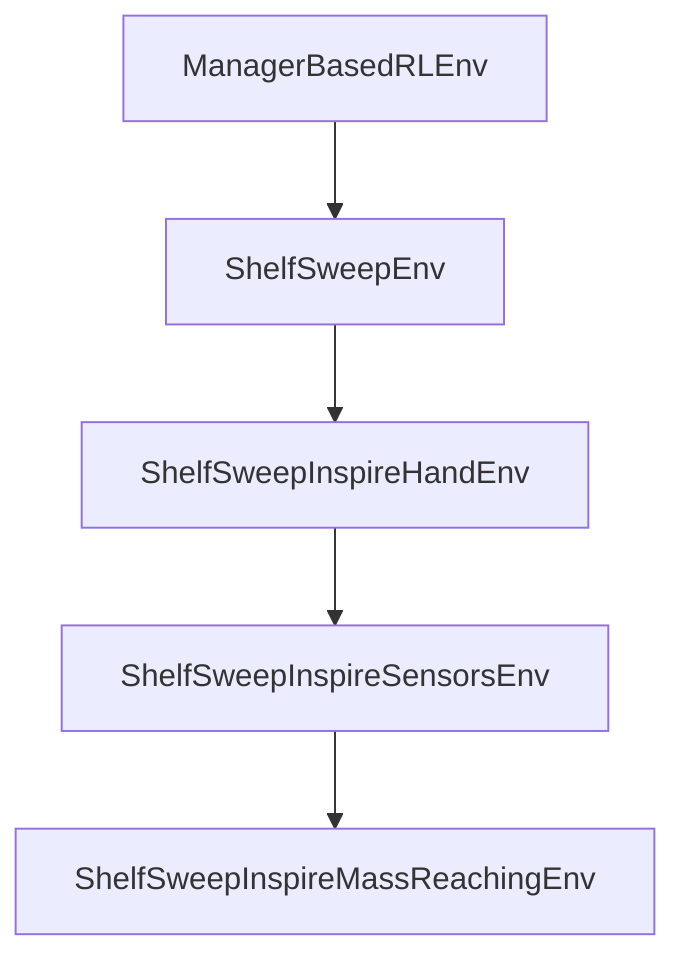

# 등록 ID와 환경 상속

[환경 목록](README.md) · [설치·실행](../README.md) · [개발 로그](DEVELOPMENT_LOG.md)

2026-10-14의 [등록 코드](../sweeping_policy/__init__.py)를 읽어 정리한 **30개** Gymnasium 환경이다. 표의 config class는 링크된 파일에 있고, 직접 부모는 해당 class 선언에서 확인했다. 이 목록은 실제 시뮬레이터 실행 결과가 아니다.

등록 문자열의 `Random--Non-Tracking` 이중 하이픈과 `Inspire-Open-v3` / `Inspire-Open-v3-mass` 구분을 그대로 사용한다. 접미사만 보고 상속 관계나 action 차원을 추정하지 않는다.

## Config 상속

`UR5eShelfEnvCfg`는 `ShelfSweepEnvCfg`, `UR5eSweepEnvCfg`는 `ShelfSweepRandomEnvCfg`에서 시작한다. 두 공통 config는 Isaac Lab의 `ManagerBasedRLEnvCfg`를 상속한다. 아래 표는 등록된 config의 직접 부모를 모두 기록한다.

| Task ID | Config class와 구현 | 직접 부모 | Runtime / PPO |
|---|---|---|---|
| `Isaac-Sweep-Object-UR5e-v0` | [UR5eShelfEnvCfg](../sweeping_policy/config/ur5e/joint_pos_env_cfg.py) | `ShelfSweepEnvCfg` | E0 / P0 |
| `Isaac-Sweep-Object-UR5e-Random-v0` | [UR5eSweepEnvCfg](../sweeping_policy/config/ur5e/joint_pos_random_sweep_env_cfg.py) | `ShelfSweepRandomEnvCfg` | E0 / P1 |
| `Isaac-Sweep-Object-UR5e-Random-v2` | [UR5eSweepOSCEnvCfg](../sweeping_policy/config/ur5e/osc_random_sweep_env_cfg.py) | `UR5eSweepEnvCfg` | E0 / P1 |
| `Isaac-Sweep-Object-UR5e-Random-v1` | [UR5eSweepDiffIKEnvCfg](../sweeping_policy/config/ur5e/diff_ik_random_sweep_env_cfg.py) | `UR5eSweepEnvCfg` | E0 / P1 |
| `Isaac-Sweep-Object-UR5e-Random-Diff-IK-Relative-Control-Parm-AS-0.5` | [UR5eSweepDiffIK5RelativeTargetEnvCfg](../sweeping_policy/config/ur5e/diff_ik_relative_target_env_cfg.py) | `UR5eSweepDiffIKEnvCfg` | E0 / P1 |
| `Isaac-Sweep-Object-UR5e-Random-Diff-IK-Relative-Control-Parm-AS-0.6` | [UR5eSweepDiffIK6RelativeTargetEnvCfg](../sweeping_policy/config/ur5e/diff_ik_relative_target_env_cfg.py) | `UR5eSweepDiffIKEnvCfg` | E0 / P1 |
| `Isaac-Sweep-Object-UR5e-Random-Diff-IK-Relative-Control-Parm-AS-0.7` | [UR5eSweepDiffIK7RelativeTargetEnvCfg](../sweeping_policy/config/ur5e/diff_ik_relative_target_env_cfg.py) | `UR5eSweepDiffIKEnvCfg` | E0 / P1 |
| `Isaac-Sweep-Object-UR5e-Random-Single-v0` | [UR5eSweepRandomSingleEnvCfg](../sweeping_policy/config/ur5e/joint_pos_random_single_sweep_env_cfg.py) | `UR5eSweepEnvCfg` | E0 / P1 |
| `Isaac-Sweep-Object-UR5e-Random-Single-Inspire-Open-v0` | [UR5eSweepRandomSingleInspireOpenEnvCfg](../sweeping_policy/config/ur5e/joint_pos_random_single_inspire_open_env_cfg.py) | `UR5eSweepRandomSingleEnvCfg` | E0 / P2 |
| `Isaac-Sweep-Object-UR5e-Random-Single-Inspire-Open-v1` | [UR5eSweepRandomSingleInspireHandEnvCfg](../sweeping_policy/config/ur5e/joint_pos_random_single_inspire_hand_env_cfg.py) | `UR5eSweepRandomSingleInspireOpenEnvCfg` | E1 / P3 |
| `Isaac-Sweep-Object-UR5e-Random-Single-Inspire-Open-v1-mass` | [UR5eSweepRandomSingleInspireHandMassEnvCfg](../sweeping_policy/config/ur5e/joint_pos_random_single_inspire_hand_mass_env_cfg.py) | `UR5eSweepRandomSingleInspireHandEnvCfg` | E1 / P4 |
| `Isaac-Sweep-Object-UR5e-Random-Single-Inspire-Open-v1-mass-limit` | [UR5eSweepRandomSingleInspireHandMassLimitEnvCfg](../sweeping_policy/config/ur5e/joint_pos_random_single_inspire_hand_mass_env_cfg.py) | `UR5eSweepRandomSingleInspireHandMassEnvCfg` | E1 / P5 |
| `Isaac-Sweep-Object-UR5e-Random-Single-Inspire-Open-v2-mass` | [UR5eSweepRandomSingleInspireMassSensorsEnvCfg](../sweeping_policy/config/ur5e/joint_pos_random_single_inspire_mass_sensors_env_cfg.py) | `UR5eSweepRandomSingleInspireHandMassEnvCfg` | E2 / P6 |
| `Isaac-Sweep-Object-UR5e-Random-Single-Inspire-Open-v3-mass` | [UR5eSweepRandomSingleInspireMassReachingEnvCfg](../sweeping_policy/config/ur5e/joint_pos_random_single_inspire_mass_reaching_env_cfg.py) | `UR5eSweepRandomSingleInspireMassSensorsEnvCfg` | E3 / P7 |
| `Isaac-Sweep-Object-UR5e-Random-Single-Inspire-Open-v3` | [UR5eSweepRandomSingleInspireInitialMassEnvCfg](../sweeping_policy/config/ur5e/joint_pos_random_single_inspire_initial_mass_env_cfg.py) | `UR5eSweepRandomSingleInspireMassSensorsEnvCfg` | E2 / P8 |
| `Isaac-Sweep-Object-UR5e-Random-Single-Inspire-Open-v4` | [UR5eSweepRandomSingleInspirePrivilegedMassEnvCfg](../sweeping_policy/config/ur5e/joint_pos_random_single_inspire_initial_mass_env_cfg.py) | `UR5eSweepRandomSingleInspireInitialMassEnvCfg` | E2 / P9 |
| `Isaac-Sweep-Object-UR5e-Random-Single-Inspire-Open-v2` | [UR5eSweepRandomSingleInspireSensorsEnvCfg](../sweeping_policy/config/ur5e/joint_pos_random_single_inspire_sensors_env_cfg.py) | `UR5eSweepRandomSingleInspireHandEnvCfg` | E2 / P10 |
| `Isaac-Sweep-Object-UR5e-Random-Single-v1` | [UR5eSweepRandomSingleV1EnvCfg](../sweeping_policy/config/ur5e/joint_pos_random_single_v1_sweep_env_cfg.py) | `UR5eSweepRandomSingleEnvCfg` | E0 / P1 |
| `Isaac-Sweep-Object-UR5e-Random--Non-Tracking-v0` | [UR5eSweepRandomNonTrackingEnvCfg](../sweeping_policy/config/ur5e/joint_pos_random_non_tracking_sweep_env_cfg.py) | `UR5eSweepEnvCfg` | E0 / P1 |
| `Isaac-Sweep-Object-UR5e-Random--Non-Tracking-v1` | [UR5eSweepRandomNonTrackingV1EnvCfg](../sweeping_policy/config/ur5e/joint_pos_random_non_tracking_v1_sweep_env_cfg.py) | `UR5eSweepEnvCfg` | E0 / P1 |
| `Isaac-Sweep-Object-UR5e-Random-Relative-Target-v0` | [UR5eSweepDiffIKRelativeTargetEnvCfg](../sweeping_policy/config/ur5e/diff_ik_relative_target_env_cfg.py) | `UR5eSweepDiffIKEnvCfg` | E0 / P1 |
| `Isaac-Sweep-Object-UR5e-Random-Relative-Target-v1` | [UR5eSweepDiffIKRelativeTargetwoEEFEnvCfg](../sweeping_policy/config/ur5e/diff_ik_relative_target_env_cfg.py) | `UR5eSweepDiffIKEnvCfg` | E0 / P1 |
| `Isaac-Sweep-Object-UR5e-Random-Relative-Obs-v0` | [UR5eSweepOSCRelativeObsEnvCfg](../sweeping_policy/config/ur5e/osc_random_sweep_env_cfg.py) | `UR5eSweepOSCEnvCfg` | E0 / P1 |
| `Isaac-Sweep-Object-UR5e-Random-Relative-Obs-EE-Homing-v0` | [UR5eSweepOSCRelativeObsEEHomingEnvCfg](../sweeping_policy/config/ur5e/osc_random_sweep_env_cfg.py) | `UR5eSweepOSCRelativeObsEnvCfg` | E0 / P1 |
| `Isaac-Sweep-Object-UR5e-Random-Relative-Target-Joint-Space-v0` | [UR5eSweepRelativeTargetEnvCfg](../sweeping_policy/config/ur5e/joint_pos_random_sweep_env_cfg.py) | `UR5eSweepEnvCfg` | E0 / P1 |
| `Isaac-Sweep-Object-UR5e-Random-Relative-Target-Joint-Space-Random-Init-v0` | [UR5eSweepRelativeTargetRandomInitEnvCfg](../sweeping_policy/config/ur5e/joint_pos_relative_target_random_init_env_cfg.py) | `UR5eSweepRelativeTargetEnvCfg` | E0 / P1 |
| `Isaac-Sweep-Object-UR5e-Random-EE-Homing-v0` | [UR5eSweepEEHomingEnvCfg](../sweeping_policy/config/ur5e/joint_pos_random_ee_homing_sweep_env_cfg.py) | `UR5eSweepEnvCfg` | E0 / P1 |
| `Isaac-Sweep-Object-UR5e-Random-Homing-Cartesian-OSC-v0` | [UR5eSweepOSCHomingRewardCartesianEnvCfg](../sweeping_policy/config/ur5e/osc_random_sweep_env_cfg.py) | `UR5eSweepOSCRelativeObsEnvCfg` | E0 / P1 |
| `Isaac-Sweep-Object-UR5e-Random-Homing-OSC-12D-Action-v0` | [UR5eSweepKpOSCRelativeObsEnvCfg](../sweeping_policy/config/ur5e/osc_random_sweep_env_cfg.py) | `UR5eSweepOSCEnvCfg` | E0 / P1 |
| `Isaac-Sweep-Object-UR5e-Random-Single-OSC-Offset-Init-v0` | [UR5eSweepRandomSingleOSCOffsetEnvCfg](../sweeping_policy/config/ur5e/osc_random_single_offset_env_cfg.py) | `UR5eSweepEnvCfg` | E0 / P1 |

## Runtime class 상속

Config 상속은 manager term을 구성하고, runtime class 상속은 reset·step 처리에 영향을 준다. 위 표의 E0–E3는 다음 구현을 뜻한다.

| 표기 | Runtime class | 추가 동작 |
|---|---|---|
| E0 | [ShelfSweepEnv](../sweeping_policy/env.py) | target·sweep 상태를 보관하는 기본 Manager 환경 |
| E1 | [ShelfSweepInspireHandEnv](../sweeping_policy/env_inspire_hand.py) | reset 후 두 hand action/history를 fully open `[1, 1]`로 초기화 |
| E2 | [ShelfSweepInspireSensorsEnv](../sweeping_policy/env_inspire_sensors.py) | reset 뒤 stale 센서 관측을 0으로 표시, 다음 physics step에서 다시 제공 |
| E3 | [ShelfSweepInspireMassReachingEnv](../sweeping_policy/env_inspire_mass_reaching.py) | reset IK 결과와 일치하도록 arm action/history를 갱신 |

## PPO runner와 experiment

위 표의 P0–P10은 아래 entry point다. 모듈 경로의 공통 접두사는 `sweeping_policy.config.ur5e.agents`다. 같은 experiment를 공유하는 환경은 `--run_name`에 task 차이가 드러나도록 적고 실행 기록에 정확한 task ID를 남긴다.

| 표기 | Runner entry point | experiment_name |
|---|---|---|
| P0 | [rsl_rl_ppo_cfg:UR5eSweepPPORunnerCfg](../sweeping_policy/config/ur5e/agents/rsl_rl_ppo_cfg.py) | `UR5e_shelf_sweep` |
| P1 | [rsl_rl_ppo_cfg_02:UR5eSweepPPORunnerCfg](../sweeping_policy/config/ur5e/agents/rsl_rl_ppo_cfg_02.py) | `UR5e_shelf_sweep_random` |
| P2 | [rsl_rl_ppo_inspire_open_cfg:UR5eSweepInspireOpenPPORunnerCfg](../sweeping_policy/config/ur5e/agents/rsl_rl_ppo_inspire_open_cfg.py) | `UR5e_shelf_sweep_random_single_inspire_open` |
| P3 | [rsl_rl_ppo_inspire_hand_cfg:UR5eSweepInspireHandPPORunnerCfg](../sweeping_policy/config/ur5e/agents/rsl_rl_ppo_inspire_hand_cfg.py) | `UR5e_shelf_sweep_random_single_inspire_hand_v1` |
| P4 | [rsl_rl_ppo_inspire_hand_mass_cfg:UR5eSweepInspireHandMassPPORunnerCfg](../sweeping_policy/config/ur5e/agents/rsl_rl_ppo_inspire_hand_mass_cfg.py) | `UR5e_shelf_sweep_random_single_inspire_hand_v1_mass` |
| P5 | [rsl_rl_ppo_inspire_hand_mass_cfg:UR5eSweepInspireHandMassLimitPPORunnerCfg](../sweeping_policy/config/ur5e/agents/rsl_rl_ppo_inspire_hand_mass_cfg.py) | `UR5e_shelf_sweep_random_single_inspire_hand_v1_mass_limit` |
| P6 | [rsl_rl_ppo_inspire_mass_sensors_cfg:UR5eSweepInspireMassSensorsPPORunnerCfg](../sweeping_policy/config/ur5e/agents/rsl_rl_ppo_inspire_mass_sensors_cfg.py) | `UR5e_shelf_sweep_random_single_inspire_hand_v2_mass` |
| P7 | [rsl_rl_ppo_inspire_mass_sensors_cfg:UR5eSweepInspireMassReachingPPORunnerCfg](../sweeping_policy/config/ur5e/agents/rsl_rl_ppo_inspire_mass_sensors_cfg.py) | `UR5e_shelf_sweep_random_single_inspire_hand_v3_mass` |
| P8 | [rsl_rl_ppo_inspire_initial_mass_cfg:UR5eSweepInspireInitialMassPPORunnerCfg](../sweeping_policy/config/ur5e/agents/rsl_rl_ppo_inspire_initial_mass_cfg.py) | `UR5e_shelf_sweep_random_single_inspire_initial_v3_mass` |
| P9 | [rsl_rl_ppo_inspire_initial_mass_cfg:UR5eSweepInspirePrivilegedMassPPORunnerCfg](../sweeping_policy/config/ur5e/agents/rsl_rl_ppo_inspire_initial_mass_cfg.py) | `UR5e_shelf_sweep_random_single_inspire_privileged_v4_mass` |
| P10 | [rsl_rl_ppo_inspire_sensors_cfg:UR5eSweepInspireSensorsPPORunnerCfg](../sweeping_policy/config/ur5e/agents/rsl_rl_ppo_inspire_sensors_cfg.py) | `UR5e_shelf_sweep_random_single_inspire_sensors_v2` |

현재 사용하지 않는 `rsl_rl_ppo_cfg_03.py`와 `*_PLAY` config class도 소스에는 남아 있다. 등록 표의 `env_cfg_entry_point`에는 학습 config가 연결되어 있다. [play.py](../play.py)는 Isaac Lab player를 호출하므로 파일 이름만으로 `*_PLAY`가 자동 선택된다고 가정하지 않는다.

## 주요 branch 구분

- Joint-space relative-target는 `UR5eSweepEnvCfg`의 직접 자식이다. Diff-IK relative-target를 상속하지 않는다.
- Single OSC offset도 `UR5eSweepEnvCfg`의 직접 자식이다. `Random-v2` 또는 `Random-Single-v0` config를 상속하지 않고 자체 reset·OSC override를 구성한다.
- Inspire `v2`는 hand v1의 자식이다. `v2-mass`는 hand mass v1의 자식이다.
- Inspire `v3-mass`와 `v3`는 각각 `v2-mass`의 자식이다. 전자는 reaching reset, 후자는 initial target 관측을 다룬다.
- Inspire `v4`는 `v3`를 상속해 privileged critic group을 추가한다.

## 갱신 기준

등록을 추가하거나 config 부모·runtime class·runner를 변경하면 이 표와 해당 환경 설명을 함께 갱신한다. 실행 명령은 [README](../README.md)의 공통 launcher에 표의 정확한 ID를 넣는다. [개발 로그](DEVELOPMENT_LOG.md)에 바뀐 manager term·차원·검증·실행 경로를 기록한다.
